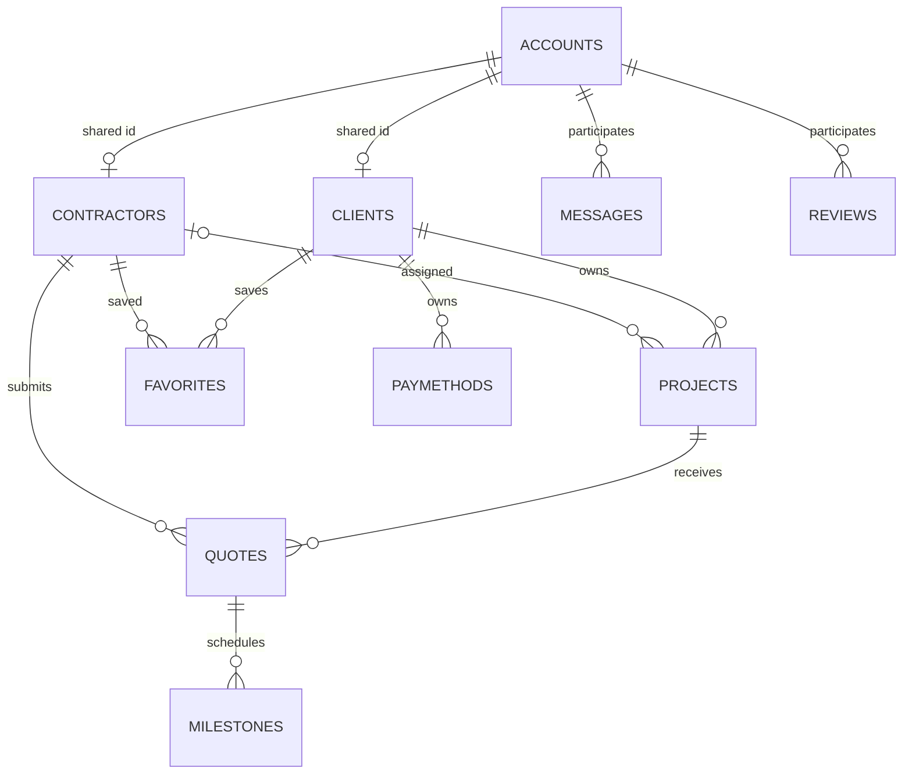

# API and data reference

This is the original assessment. [Subsequent repairs](repair-log.md) introduce canonical decoded `data`, retain serialized `body` for compatibility, correct IDs, return creation IDs and add an explicit composite favorite DELETE route. Refer to current source and the repair log when implementing new calls.

Reviewed November 15, 2026. **BE paths below are relative to the backend repository.** This describes checked-in contracts, including defects; it is not an approved future API specification.

## Base URL and execution modes

FE `src/services/axious.service.js` selects `VUE_APP_BASE_URL` only when `VUE_APP_ENV === "production"`; otherwise it selects `VUE_APP_DEV_BASE_URL`. The custom flag is independent of Vue CLI's `NODE_ENV`. A production compilation does not by itself guarantee the production API is selected.

The base URL must include the gateway stage when applicable and the `marido-backend` prefix. The documented local shape is `http://localhost:3000/dev/marido-backend`; the port/stage must match the actual offline configuration. Service calls then append resources such as `/clients`. The separate Express prototype exposes `/clients` directly and is not a drop-in replacement for this API. Legacy JSON-server mode also has different response expectations.

## Declared REST endpoints

All entries come from BE `serverless.yml`. `CRUD` below means `GET /resource`, `POST /resource`, and `GET`, `PUT`, `DELETE /resource/{parameter}`. This abbreviation describes route availability, not access permission or correct implementation.

| Resource | Declared routes beyond CRUD | Item parameter | Handler module |
| --- | --- | --- | --- |
| `contactus` | None | `contactUsMsgId` | `contactUsController.ts` |
| `contractors` | None | `contractorId` | `contractorsController.ts` |
| `clients` | `GET /clients/getbyprojectid/{projectId}` | `clientId` | `clientsController.ts` |
| `projects` | `GET /projects/clients/{clientId}` | `projectId` | `projectsController.ts` |
| `favorites` | `GET /favorites/clients/{clientId}` | `favoriteId` | `favoritesController.ts` |
| `messages` | Five POST operations listed below | `messageId` | `messagesController.ts` |
| `milestones` | None | `milestoneId` | `milestonesController.ts` |
| `quotes` | None | `quoteId` | `quotesController.ts` |
| `reviews` | `GET /reviews/clients/{clientId}` | `reviewId` | `reviewsController.ts` |
| `accounts` | `POST /authenticate`, `POST /accounts/setavatar/{accountId}` | `accountId` | `accountsController.ts` |
| `paymethods` | `GET /paymethods/clients/{clientId}` | `paymethodId` | `payMethodsController.ts` |
| `logtrail` | `GET /logtrail/clients/{clientId}` | `logtrailId` | `logTrailController.ts` |

Additional routes: `GET /ping` → `src/controllers/.ping.ts:handler`; `GET /clientes` → `src/sequelizer/controllers/clientSqlController.ts:getClientFromController`.

### Message operations

| POST path | Current request fields | Behavior |
| --- | --- | --- |
| `/messages/getMyContactList` | `myself` | Resolve accounts participating in messages with that account |
| `/messages/getConversationByContactId` | `myself`, `contactId` | Up to 100 chat messages; no explicit ordering in SQL |
| `/messages/setMsgsAsReadByContactId` | `fromId`, `toId` | Mark chat messages read/uploaded |
| `/messages/getNrOfNewMessages` | `id` | Count messages addressed to account |
| `/messages/getNrOfNewMessagesByContactId` | `fromId`, `toId` | Count messages in one direction |

These IDs come from unvalidated request bodies in the current implementation. They must ultimately be scoped against authenticated identity; parameterization alone would not prevent one user reading another user's conversation.

## Actual response serialization

BE `src/models/responseDataSet.ts` returns an API Gateway proxy object. API Gateway interprets its outer `statusCode`, `headers` and `body`; Axios receives the decoded inner object:

```js
// What the browser normally sees in response.data:
{
  message: "...",
  body: "[{\"projectId\":123}]" // another JSON string
}
```

The helper serializes `data[0]`, not `data`. mysql2 promise queries return `[rows, fields]`. Consequently:

| Handler argument to helper | Browser `JSON.parse(response.data.body)` |
| --- | --- |
| Full mysql2 query result `ds` | Row array |
| Row array `ds[0]` | First row object; additional rows discarded |
| `[ds[0]]` | Row array, used for the account insert-ID lookup |
| Empty array `[]` | `body` property omitted, because `JSON.stringify(undefined)` yields undefined |

This explains why list and item calls disagree, and why a mutation can return HTTP 200 without a parseable inner body. `getAccounts` passes `ds[0]`, so its apparent list endpoint only serializes the first account. A no-result item query can omit `body` rather than return 404. FE code variously reads `response.data`, `response.data.body`, and parsed strings inside actions or mutations.

The helper always sets HTTP 200 and combines wildcard origin with credential support. Many handler catch blocks call Express-style `next(err)`, although Lambda's third argument is a completion callback. There is no unified validation/error envelope.

Suggested future contract, to introduce with coordinated FE changes:

```json
{"data": [{"projectId": 123}], "meta": {"count": 1}}
```

Use an object for item `data`, a row array for list `data`, explicit create IDs, and appropriate 201/204/400/401/403/404/409/500 statuses. This contract is a proposal, not implemented behavior.

## Entity map

The SQL snapshots are the best available structural reference, but they were not compared with a live schema. Multiple copies differ. `src/interface` is incomplete and sometimes contradicts these snapshots.



Relationships in the diagram are a mixture of declared foreign keys and logical references. The per-table snapshots declare account/profile, project/profile, favorite/profile and payment-method/client foreign keys. Quotes, reviews and messages lack corresponding foreign keys in their individual snapshots; milestone structure is in `src/sql/db.sql` and interfaces. Do not assume the whole diagram is enforced by the database.

| Entity / primary key | Purpose and representative fields | Important discrepancies |
| --- | --- | --- |
| `accounts.id` | User identity/profile discriminator, email, first/last name, userType, avatar | Stores password/token-related columns despite Cognito; no unique Cognito-sub mapping demonstrated |
| `clients.id` | Contact/address/social profile sharing account ID | FE listing mutation writes to nonexistent `state.favorites` |
| `contractors.id` | Professional services, description/company, geographic details, bank/account fields | Public listing uses `SELECT *`, exposing fields intended for private use if deployed as written |
| `projects.projectId` | Owner, optional contractor, title, services, dates, status, intention, property type, avatar | FE assumes generic `id` in some mutations; creation supplies contractor 0 rather than null |
| `quotes.quoteId` | Project/contractor, bid and agreed price, state, client confirmation | Item SQL filters `id`, contradicting snapshot `quoteId`; missing project/client lookup routes |
| `milestones.milestoneId` | Quote-linked stages, amounts, release/approval and payment dates | CRUD exists, but no demonstrated payment lifecycle or transaction guarantees |
| `messages.messageId` | Sender/recipient, optional quote, text/assets, type and read/upload flags | GET/PUT handler reads `messagesId`; unread checks compare numeric flag to string `'false'` |
| `favorites.Id` | Client/contractor association | Casing differs across layers; delete includes a literal `undefined` URL workaround |
| `reviews.reviewId` | Reviewer/reviewed account, project, title/comments, rating, approval | Interface uses `fromUserId`, `toUserId`, `review`, `wasApproved`; SQL uses `reviewedById`, `reviewedToId`, `comments`, `isApproved` |
| `paymethods.payMethodId` | Client payment details | Raw card and CVC columns; interface `expiration` differs from SQL/FE month/year |
| `contactus.id` | Contact, service and registration inquiries | Broad contractor-like fields and NOT NULL requirements do not match simple booking payloads; mapping uses `comments` while snapshot has `message` |
| `log_trail.id` | Actor, action, origin, session and wall-post flag | Controller also refers to `logtrails` and `Log_Trail`; JWTs can be passed into `sessionId` |

## Specific contract gaps to resolve

1. FE `quotes/actions.js:getQuotesByClient` requests `GET quotes/clients/{clientId}`, absent from `serverless.yml`.
2. FE `quote.service.js:getByProjectId` dispatches `quotes/getByProjectId`, absent from the quotes actions, and supplies a field named `clientId`.
3. FE `messages/actions.js:getMessagesByClient` requests `GET messages/clients/{clientId}`, absent from `serverless.yml`; `message.service.js` also dispatches a missing `messages/getByProjectId` action.
4. Generic FE `apiSvc.update/delete` uses `entity.id`, but projects, reviews, messages, quotes and payment methods use domain-specific primary keys.
5. `messages/{messageId}` is declared, but GET/PUT read `messagesId`. `logtrail/{logtrailId}` is declared, but GET/PUT read `logtrailsId`.
6. Quote item GET/PUT/DELETE use SQL column `id`, while the quote snapshot declares `quoteId`.
7. FE `auth` requires `response.statusText === "OK"`, coupling success to a transport reason phrase instead of the numeric status/data.
8. FE project services are serialized with single-quoted elements (for example `['painting']`), which is not JSON even though comments describe later `JSON.parse` use.

These are source-confirmed mismatches. Whether each path is reached by the current UI, and whether the deployed database has drifted to compensate, requires isolated integration testing.
