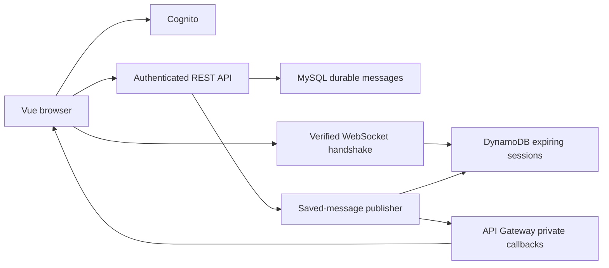
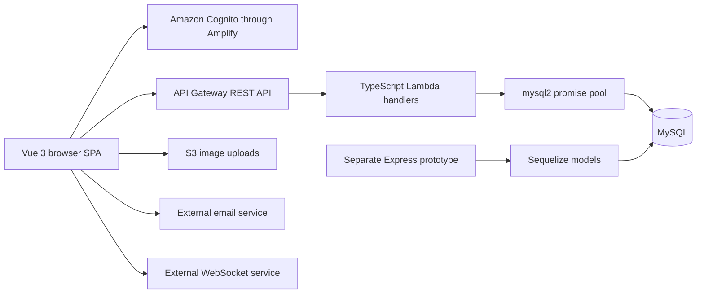

# Current deployed architecture — November 16, 2026

All AWS resources/data are development. Vue/Vuex/Amplify communicates with Cognito, the existing API Gateway REST API and the existing WebSocket endpoint. All 76 REST functions and one managed socket function run Node 24. The nearly full REST stack remains at 486 resources; an isolated six-resource chat stack owns the connection table, socket handler, log group, permission and two scoped roles. The old standalone unauthenticated handler is disabled and unrouted.

REST verifies Cognito claims and SQL subject/account binding, scopes private data to owners/participants and provisions profiles transactionally after verified login. MySQL is the durable source for accounts, projects, quotes and messages. Secrets Manager supplies a DML-only principal; RDS TLS verifies the CA and each execution environment uses a two-connection pool. Secure owner-specific photo grants write public profile/project images to S3. Raw payment/milestone writes remain disabled pending product/provider decisions.

WebSocket identity is verified during the handshake using a token in the subprotocol header, with no token in the URL, connection table or request logs. DynamoDB maintains transactional connection/account indexes across Lambda instances and tabs. JWT expiry is enforced independently of eventual TTL deletion. The REST message publisher builds live events from the saved SQL row and targets only verified sender/recipient sessions; browsers cannot publish arbitrary socket messages or choose another sender. Presence is scoped to the caller's contacts. Strongly consistent connection queries, frontend deduplication and reconnect history catch-up replace the old process-local dictionary/protocol mismatch. Live push remains best effort after persistence, not a transactional outbox.

Project acceptance locks project before quote and commits confirmation/quoted price/assignment together. Completion and participant/duplicate review guards are enforced; moderation/admin workflows remain incomplete. Direct account-to-account messaging keeps existing product behavior and does not require a project relationship.

Latest evidence and remaining work: [chat release](releases/2026-11-16-chat.md), [workflow release](releases/2026-11-16-journey.md), [hardening release](releases/2026-11-16-hardening.md), [handoff](HANDOFF.md), [tickets](asana-tickets.md). Notification email DNS/service remains unavailable; live-chat delivery/identity/participant acceptance passed. Pagination, coordinated deletion, moderation, attachments/read-receipt UX, CI/monitoring and restore drills remain work.

The purpose/domain assessment below is historical. Current implementation statements above and the handoff supersede its older Node 18/upload-permission/route-defect observations.

---
# Purpose and architecture

This is the November 15, 2026 architecture assessment. Subsequent source repairs and current limitations are recorded in [the repair log](repair-log.md) and [ticket ledger](asana-tickets.md).

## Product purpose

Marido en Alquiler is a Spanish-language services marketplace connecting homeowners/clients with handyman and service professionals. The existing FE README identifies the Dominican Republic as the initial market. Other country imagery exists, but it does not establish a completed multi-country product.

The intended journey is: discover a professional or publish a project, receive offers, communicate, agree on the work, and review the experience. Payment methods, milestones, and administrative pages suggest a broader transaction platform, but their presence does not establish working payment collection, escrow, or payouts.

| Actor | Intended capabilities | Evidence and current maturity |
| --- | --- | --- |
| Visitor | View services and instructions, search professionals, send inquiries, register/sign in | Landing, search, booking, contact and authentication components exist |
| Client | Maintain profile, publish/manage projects, save professionals, message, review, manage payment methods | Routed profile sections and Vuex modules exist; API and workflow defects remain |
| Contractor | Maintain professional profile, browse projects, submit offers, communicate | `/profile`, `/projectlist`, bid and chat components exist; contractor route guard has a typo |
| Administrator | Maintain users, view reports, issue payments | Files under `src/pages/admins` are placeholders and are not registered in `src/router.js` |
| Hardware-store/referral participant | Learn about referral participation | Informational `/comoferreterias` page; no distinct operational backend domain demonstrated |

## System shape

The API Gateway/Lambda route is the primary backend described by `serverless.yml` and consumed by the FE. The diagram reflects repository configuration and call sites, not a verified inventory of deployed AWS resources. S3 hosting is mentioned in the FE README; CDN, DNS, TLS and SPA fallback behavior need deployment verification.

The application has two repositories, one browser application, and one domain API with many Lambda functions. It is not a set of independently owned domain microservices. Email and live-message infrastructure are separate dependencies whose implementations were not found in these repositories.

## Frontend structure

| Location | Responsibility |
| --- | --- |
| `src/main.js` | Creates Vue app; configures Amplify; installs router, Vuex and plugins; registers global components/mixins; mounts after cached authentication bootstrap |
| `src/App.vue` | Navbar, footer, breadcrumbs, global spinner/modal, router outlet |
| `src/router.js` | History-mode routing, public pages, client and contractor profile sections, auth navigation guard |
| `src/pages/clients`, `src/pages/contractors` | Actor-specific screens |
| `src/pages/common` | Landing, auth, help/legal, chat, payment-method screens |
| `src/components/ui` | Shared cards, booking, bidding, upload, modal and rating components |
| `src/store/index.js` | Root UI state, environment flags and auth bootstrap |
| `src/store/modules` | Auth, clients, contractors, contactus, reviews, favorites, payMethods, logTrail, quotes, messages, chat and generic project API access |
| `src/services/axious.service.js`, `api.service.js` | Axios instance, base URL selection and generic CRUD calls; spelling `axious` is the actual filename |
| Other `src/services` | Domain classes that frequently dispatch Vuex actions, plus storage, email, AWS upload and socket integrations |
| `src/utils/types.js` | Action/type constants and static lookup values such as service categories |
| `src/css`, `src/js`, `public`, `src/img` | Theme styling/scripts, vendor assets and template/demo imagery |
| `amplify` | Amplify project metadata; generated `src/aws-exports.js` is ignored by Git |

Typical flow is component → domain helper and/or Vuex action → Axios/API → mutation → reactive UI. The paths are inconsistent: some screens use classes, some dispatch directly, booking uses `src/assets/js/contactUsEngine.js`, email uses `fetch`, and uploads call S3 directly. Generic project actions are nested beneath `subStore` but not all parent modules are namespaced; call sites use `projects/...`.

Most screens use Vue's Options API. Vuex auth and generic API actions share the root namespace; domain modules such as clients are namespaced. Service barrel exports and services importing the store create tight coupling and circular dependencies. These choices matter when extracting or testing a workflow.

## Routes and reachability

| Area | Routes |
| --- | --- |
| Public | `/`, `/booking`, `/contactus`, `/comoclientes`, `/comocontratistas`, `/comoferreterias`, `/ayuda`, `/busqueda`, `/projectlist` |
| Authentication/legal | `/login`, `/olvide`, `/signout`, `/privacidad`, `/terminos` |
| Client account | `/perfil`, `/perfil/info`, `/perfil/seguridad`, `/perfil/proyectos`, `/perfil/favoritos`, `/perfil/mensajes`, `/perfil/reviews`, `/perfil/notificaciones`, `/perfil/formas-pago` |
| Contractor account | `/profile`, `/profile/info`, `/profile/notificaciones` |
| Project creation | `/nuevoproyecto` |
| Other | `/comenta`, `/aprendamas` (construction content), `/helper` (chat), `/testpad` (test component), `/notfound`, catch-all |

Route presence is not proof of feature completion. `/perfil` is guarded by `requiresAuth`; `/profile` uses `requiredAuth`, which the guard does not inspect. There are no role checks in that guard. Signup and confirmation exist as components rather than separate top-level routes; inspect their parent authentication UI for changes.

## Authentication and identity flow

1. `auth/actions.js:login` calls Amplify `Auth.signIn(email, password)` against Cognito.
2. It calls BE `POST authenticate` with the email to resolve the SQL account ID and user type.
3. The Cognito token, SQL ID and a calculated expiration are cached in local storage; Vuex loads the client or contractor record.
4. `src/store/index.js` dispatches `tryLogin` at startup. Both router navigation and app mounting wait for this promise.
5. Cached login reads local storage and retrieves `accounts/{id}`; it does not establish a freshly validated Cognito session before marking the UI signed in.
6. Signup attempts Cognito creation, then SQL account creation, then a client/contractor profile using the account ID. These operations are not atomic and some promise chains are not returned.

The SQL account is the shared identity record: clients and contractors reuse its numeric ID. A durable, unique Cognito `sub` association is not established by the inspected signup flow. BE `authenticate` is an email lookup, not password/JWT validation. Neither server-side JWT validation nor a gateway authorizer is declared in the reviewed API source. FE `apiSvc.setHeader` exists, but the main Cognito login flow does not call it. See R01–R06 in the review before expanding account features.

## Backend structure

| Location | Responsibility |
| --- | --- |
| `serverless.yml` | AWS provider, region, Node runtime, REST event routes, TypeScript and offline plugins |
| `src/controllers/*Controller.ts` | API Gateway Lambda exports, JSON parsing, direct SQL and result serialization |
| `src/db.js` | Primary mysql2 promise pool; currently selects JSON configuration's `production` entry regardless of `NODE_ENV` |
| `src/models/responseDataSet.ts` | Common HTTP 200 response helper, nested JSON serialization and CORS headers |
| `src/interface/*.ts` | Compile-time domain shapes; these do not validate request bodies at runtime |
| `src/sql/*.sql` | Per-table SQL snapshots; not an ordered migration system |
| `src/app.ts`, `src/index.ts` | Separate Express server with root and client prototype endpoints |
| `src/sequelizer` | Sequelize model loader, client/post models and alternative client controller |
| `src/database.ts`, `src/db.query.js` | Additional database connection/query approaches, also selecting production configuration |
| `template.yml` | Separate SAM/CodeDeploy example with datetime functions and Node 10 settings; not equivalent to the domain API |

Most domain requests go directly from controller to mysql2. There is no consistent service/repository layer for ownership, validation, transactions or business rules. Sequelize is an alternate/legacy path, not the ORM used throughout the Lambda CRUD handlers.

## Important workflow boundaries

The bullets below describe the original assessment. Current email behavior is superseded by the [deployed notification release](releases/2026-11-16-notifications.md): backend-owned SES notices after committed quotes/non-chat messages, fixed support delivery, separate saved/delivery results, scoped Lambda roles and a DynamoDB event/rate table. Zoho hosts the inboxes; SES authenticates with its own DKIM and bounce-app MAIL FROM. The browser no longer invokes the external mailer. See current handoff/releases for the repaired upload, quote and authenticated-chat boundaries as well.

- **Project creation:** screen validates, optionally starts S3 upload, submits project data through generic Vuex actions. Upload completion is not awaited, failures can be swallowed, and the project is created with `contractorId: 0` despite a nullable foreign key in the SQL snapshot.
- **Bidding:** `baseProjectBid.vue` creates a quote through the `Quote` class, then starts client notification and clears the form. The quote helper/action do not propagate persistence completion reliably. Notification uses the project ID as `quoteId`.
- **Messaging:** REST stores/history/contacts/read counts are in the BE; `ChatApp.vue` separately connects through a class named `SocketioService` that actually uses native `WebSocket`. No corresponding WebSocket server is declared in BE `serverless.yml`.
- **Email:** browser calls an external service at `VUE_APP_EMAIL_SVC_URL`, using `/mailer`, `/subscribe`, `/contact`. Vue components generate some email HTML. Reliability and authorization of the external service are unknown.
- **Images:** browser uses AWS SDK v2 with hardcoded credentials and original filenames as S3 keys. Profile/project uploads need a server-authorized upload design.
- **Payments:** payment-method capture and CRUD exist, including raw card/security-code fields. `makeAPayment.vue` is a heading-only placeholder; backend milestones are generic records, not demonstrated payment execution.

## Where to change things

| Request | Main FE locations | Main BE locations |
| --- | --- | --- |
| Sign-in/signup/session fixes | `pages/common/authenticate`, `store/modules/auth`, `services/api.service.js` | `accountsController.ts`, gateway authorizer, accounts schema |
| Client/professional profile | `pages/clients/profile-info.vue`, `pages/contractors/profile-info.vue`, corresponding stores | `clientsController.ts`, `contractorsController.ts`, profile SQL |
| Project posting/search | `pages/clients/addProject.vue`, `pages/contractors/projectSearch.vue`, `store/modules/genericApiSvc` | `projectsController.ts`, project schema |
| Offers and acceptance | `components/ui/baseProjectBid.vue`, `services/quote.service.js`, quotes store | `quotesController.ts`, quote schema and new transition rules |
| Favorites/reviews | Client pages and corresponding stores | `favoritesController.ts`, `reviewsController.ts`, associated SQL |
| Chat/unread counts | `pages/common/chat`, messages/chat stores, socket services | `messagesController.ts` plus external WebSocket repository/configuration |
| Images/email | Upload components, S3/email services, email templates | New authorized upload/notification handlers or integration with external service |
| Payments/admin | Payment and admin placeholders | Provider integration, webhook processing and authorization need definition |

## Suggested architectural direction

Retain the existing marketplace boundaries while first making one client/contractor journey reliable. Consolidate the backend execution path around the declared Lambda API, put identity/authorization and validation at its boundary, isolate SQL behind a small data layer, and normalize the response contract. Consolidate browser API calls into typed domain clients with predictable errors.

Introduce migrations, safe development configuration and a small meaningful test suite before changing framework/build tooling broadly. Payment processing, notification delivery and WebSocket hosting need explicit ownership and acceptance criteria. These are proposals, not changes made by this review.

## Latest deployment: restricted DB principal and signed photos

The [hardening release](releases/2026-11-16-hardening.md) moves the app to Node 24 and a DML-only database account. The Lambda role no longer reads the administrator secret; its old password and the exposed browser-upload key were retired. Browser image writes use authenticated backend grants with exact random owner keys, short expiry, bounded size and safe types; persisted references also receive object-header validation. Account/profile image updates commit together. Photos remain public; orphan/replacement lifecycle work remains. The browser AWS SDK was removed. The stack now has 486 of 500 resources, so consolidate before growing infrastructure.
